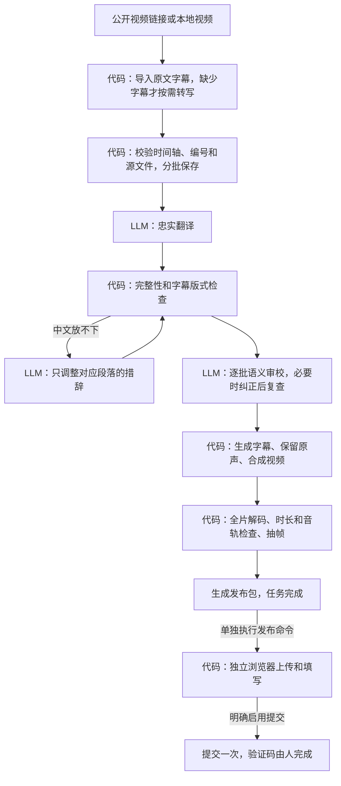

# 字幕优先的视频处理流程

`workflow.py` 将下载、字幕导入、翻译批次、审校、合成、检查和发布准备固化为一个可恢复的任务。它适用于“保留原片和原声，制作中文或中英字幕”的工作；当前输出译文限定为中文。

这条 CLI 流程使用独立任务目录，不使用 Streamlit 的全局 `output/`，也不需要 MCP 服务在后台运行。它复用 VideoLingo 的依赖、API 配置和本地 ASR 后端。原有 Streamlit、HTTP API 和独立 MCP 入口继续使用各自的流程。



| 环节 | 实现方式 | 为什么 |
| --- | --- | --- |
| 下载、原文字幕选择、时间轴和编号 | 代码 | 有明确输入、输出和校验规则 |
| 无字幕时识别原声 | 本地 ASR，显式启用 | 使用专用语音模型，不经过通用 LLM |
| 翻译、术语和语义检查 | LLM | 需要理解上下文、数量、归属、否定和表达 |
| 中文字幕是否放得下 | 代码先检查；仅超长段请求 LLM | 不用模型估计像素，也不静默截断字幕 |
| 字幕排版、视频合成、解码检查、恢复 | 代码 | 可重复执行和验证 |
| 发布标题和简介 | 代码模板 | 默认不额外请求模型生成文案 |
| 上传、填写、提交状态记录 | 可选浏览器适配器 | 不由 LLM 决定下一步操作 |
| 登录、验证码、最终内容验收 | 人 | 账号验证及内容确认需要实际操作 |

## 安装与启动

在仓库根目录使用 Python 3.12。已有 VideoLingo 环境可安装新增的轻量依赖：

```bash
python -m pip install -i https://pypi.tuna.tsinghua.edu.cn/simple -r requirements-workflow.txt
python workflow.py --help
```

需要可用的 FFmpeg、ffprobe 和中文字体；FFmpeg 必须包含 `ass` / libass 滤镜。Ubuntu 可安装 `ffmpeg fonts-noto-cjk`。macOS 可使用支持 libass 的 FFmpeg 发行版，系统 PingFang 可用于字幕。若自动找到的 FFmpeg 缺少滤镜，用进程级设置选择正确版本：

```bash
VIDEOLINGO_FFMPEG_DIR=/path/to/ffmpeg/bin python workflow.py run input.mp4 \
  --subtitles input.en.srt --job-dir workflow-jobs/example
```

可用 `VIDEOLINGO_FONT_PATH=/absolute/path/font.ttc` 显式指定中文字体。程序按该字体的实际宽度换行，英文按词换行。

最短用法：

```bash
python workflow.py run "https://www.youtube.com/watch?v=VIDEO_ID" \
  --job-dir workflow-jobs/video-id

python workflow.py run /path/to/input.mp4 \
  --subtitles /path/to/input.en.vtt \
  --job-dir workflow-jobs/local-video
```

公开视频链接会先规范化，保留 YouTube 视频 ID，移除认可的分享跟踪参数。带凭据、签名或未知查询参数的 URL 会被拒绝；其他站点目前仅接受无查询参数的公开链接。登录、cookie 下载和受限视频不在这条流程内，可先用已有工具取得本地文件。

原文字幕的优先级是：显式 `--subtitles` → 本地同名 SRT/VTT，或网页可用的人工字幕 → 网页自动字幕 → 显式启用的本地 ASR。自动字幕仍需满足有序、不重叠等时间轴规则。程序不擅自重排字幕或用中文译文推算新时间轴。超出片尾的结束时间会夹到实际片尾，并记录原值和调整值；片尾之后才开始的字幕会被拒绝。

没有原文字幕时，默认停止。已有本地语音模型和完整 VideoLingo 环境时可用：

```bash
python workflow.py run /path/to/input.mp4 --asr --source-language en \
  --job-dir workflow-jobs/asr-video
```

`--asr` 使用仓库根目录 `config.yaml` 的 `whisper.backend`、模型选择和 `model_dir`，相对模型目录按仓库根解析；`--config` 仅用于 API 翻译配置。ASR 在新建的隔离目录中运行，白名单复制本地识别配置，保留原始识别文本，避免旧的表格转换丢弃长词。该路径强制本地后端，启用模型库离线设置并拒绝 Python TCP 连接，不自动切换云服务。模型和后端需预先安装；这不是操作系统级网络隔离。

## 三种语言调用方式

### Codex CLI（默认）

需要已安装、已登录且能使用所指定模型的 Codex CLI。流程固定分批调用，仅发送翻译、超长译文修订和语义审校请求：

```bash
python workflow.py run input.mp4 --subtitles input.en.srt \
  --provider codex --model gpt-6.1-sol --reasoning medium \
  --job-dir workflow-jobs/codex-example
```

代码传入 JSON 输出约束，要求语言调用不使用工具，并以只读、临时会话运行。请求的模型和推理档位写入任务记录；该记录不能证明服务端实际使用了哪一版本模型。账号和模型的可用性由本机 Codex 配置决定。

### VideoLingo 已配置的 API

```bash
python workflow.py run input.mp4 --subtitles input.en.srt \
  --provider api --config /path/to/config.yaml \
  --job-dir workflow-jobs/api-example
```

使用配置中的 `api.model`、`api.base_url`、`api.key` 和 JSON 模式。`--model`、`--reasoning` 是 Codex 选项，不覆盖 API 模型配置。任务只保存模型名及非秘密的端点摘要，不复制密钥。任务开始后更换 API 模型或端点需要新任务；轮换同一服务的密钥可以继续。该调用使用现有服务，费用按服务本身计收。

### 当前聊天或其他外部 LLM

```bash
python workflow.py run input.mp4 --subtitles input.en.srt \
  --provider external --job-dir workflow-jobs/external-example
```

程序在需要语言处理时暂停，`pending_requests` 指向 `requests/<request_id>.json`。文件包含完整指令、上下文、源摘要、请求编号、结果 schema 和导入信封格式。让当前聊天中的 LLM 读取这些文件并生成响应；不要让它修改视频或决定执行步骤。

翻译响应示例（实际编号和摘要必须来自请求文件）：

```json
{
  "request_id": "请求文件中的64位摘要",
  "source_digest": "请求文件中的源摘要",
  "result": {
    "translations": [{"id": 1, "text": "对应第一段的中文译文"}]
  }
}
```

审校响应的 `result` 为：

```json
{
  "issues": [
    {"id": 1, "reason": "原文说合计，译文误写为每人", "replacement": "该段完整、正确的中文译文"}
  ],
  "uncertainties": []
}
```

```bash
python workflow.py import-response --job-dir workflow-jobs/external-example \
  --file /path/to/response.json
```

每个响应必须精确覆盖请求的编号，禁止缺条、多条、重复编号和修改时间轴。来源、指令、供应方式及请求编号共同绑定响应；不接受其他视频或其他轮次的结果。可按任意顺序导入已请求的翻译批次。已保存的成功结果不会因中断而重新调用。

语义审校逐批检查，包括“前十名合计持有 2%”与“每人持有 2%”之类结构检查发现不了的错误。每批最多三轮，循环修订会停止。超长中文最多修订两次，并重新接受语义审校；无法忠实缩短就停止，不删减事实强行合成。原文字幕过长时需在新任务中提供更细的原文字幕。没有词级时间证据时，程序不替原文随意分配时间。

## 查看、恢复和产物

```bash
python workflow.py status --job-dir workflow-jobs/example
python workflow.py resume --job-dir workflow-jobs/example
```

任务目录包含：

| 文件或目录 | 用途 |
| --- | --- |
| `workflow.json` | 固定输入和配置、当前阶段、错误、源摘要、产物摘要 |
| `translations.json` | 每批保存的译文 |
| `requests/`、`responses/` | 有来源绑定的语言请求和已校验响应 |
| `review-progress.json`、`layout-progress.json` | 跨次恢复仍生效的重试次数 |
| `structure-check.json` | 字幕完整性、数字差异等结构检查 |
| `semantic-review.json` | 对应译文版本的模型审校记录及不确定项 |
| `renders/<attempt>/` | 成片、ASS、双语/中文/原文 SRT、解码检查和预览图 |
| `publication.json` | 冻结的视频和发布信息，以及可变的发布状态 |

`completed` 表示本地视频和字幕产物已生成并通过代码检查。默认输出 1920×1080：原画面完整缩放到上方区域，底部留字幕带；原音轨直接复制。无法封装原音轨时明确失败，不偷偷换成新配音。检查包含时长、音轨数量和全片解码，预览最多十张。

模型审校通过会单独记录；结构检查和全片解码均不能证明翻译准确，也不等于人工内容验收。`human_acceptance` 不会被自动设为真。

新任务必须使用空目录。输入、模型、词表等改变时使用新目录。源视频、已验证译文、审校记录或成片被改变后会拒绝继续发布，避免把不同版本混到同一任务。失败的合成目录会保留；新尝试写入新目录。合成验证完成后先持久化检查点，再生成发布包，因此即使此时中断也复用同一份成片。

常见暂停状态：`awaiting_translation`、`awaiting_layout`、`awaiting_review` 需要外部响应；`needs_revision` 表示自动修订已耗尽或原文不满足版式；`failed` 表示依赖、输入或运行出错，修复原因后用 `resume`。`completed` 与发布状态分别记录。

## 可选的抖音发布

本地处理不会自动打开网站或上传。安装可选浏览器依赖并预先准备 Chromium：

```bash
python -m pip install -i https://pypi.tuna.tsinghua.edu.cn/simple 'playwright>=1.58,<2'
python -m playwright install chromium
```

需要上传时单独运行：

```bash
python workflow.py publish --job-dir workflow-jobs/example
```

这会使用独立的可见浏览器上传、填写标题和简介，停在待发布页面。检查内容后，明确启用提交：

```bash
python workflow.py publish --job-dir workflow-jobs/example --publish
```

发布前会复查源、译文、成片及冻结的发布包。恢复提交只允许连接绑定的原浏览器页面，页面或视频身份不能确认时转为人工处理，不重传。封面和章节目前保存在发布包内，需要在网页中手动处理；修改标题、简介或视频会使自动恢复校验不再通过。

独立浏览器在命令结束后保留，便于完成登录或短信验证。默认登录资料存于本机 `~/.videolingo/douyin-browser-profile`，不放进任务目录或仓库。可通过 `--profile-dir` 选择其他本地独立目录。其调试端口仅绑定本机，结束操作后关闭该独立窗口。

发布阶段区分 `prepared`、`needs_login`、`uploading`、`uploaded`、`publishing`、`awaiting_verification`、`upload_unknown`、`publication_unknown` 和保留的 `published` 状态。上传和提交前先落盘记录意图；提交后遇验证码、断开或未知结果，后续只观察原页面，不再点击发布。验证码需要人完成，不能将“点过发布”视为已经发布成功。当前抖音适配器尚无经过实站验证的投稿回执解析，因此不会仅凭作品 URL 或 ID 自动记为 `published`；最终结果需要到原页面或创作者中心人工核对。网站定位、账号身份及本次投稿与作品的对应关系仍待真实页面验证。

## 原有主流程的可选设置

原有 Streamlit / HTTP API 保持 `processing_policy.mode: legacy`。若希望其语义分句优先用规则、默认关闭自动摘要、润色和配音时长裁剪，可在该流程的配置中选择：

```yaml
processing_policy:
  mode: code_first
  auto_summary: false
  polish: false
  trim_for_dubbing: false
```

此设置不把原有流程切换成新的 CLI，也不承诺原有流程只剩两种 LLM 调用。它只是对现有若干语言步骤增加可选策略；完整的固定状态机、逐批语义审校和独立任务恢复使用 `workflow.py`。

## 开发验证

新增测试使用临时任务和本地合成小视频，涵盖外部请求往返、语义修订、版式修订、跨进程锁、中断后继续、发布包绑定、源文件变化和真实 FFmpeg 解码。发布状态机用模拟浏览器验证，不会上传或发表内容。ASR 适配测试不下载或推理模型。

```bash
python -m pytest -q tests/test_video_workflow.py tests/test_workflow_*.py \
  tests/test_processing_policy.py tests/test_source_language.py
```

CI 安装带 libass 的 FFmpeg、Noto CJK 字体和 Chromium，运行实际小视频合成及本地页面的浏览器断连/恢复测试；浏览器依赖或可执行文件缺失会明确失败。真实网站下载、语音模型推理、供应商 API、账号登录和发布各自需要独立的集成验证，不能用离线测试结果代替。

Linux CI 若由 Chromium 明确报告浏览器沙箱不可用，仅该受控本地文档测试允许用临时启动包装继续；实际发布适配器不改变浏览器沙箱设置。在 Linux 运行发布适配器仍需主机具备可用的 Chromium 沙箱环境。
